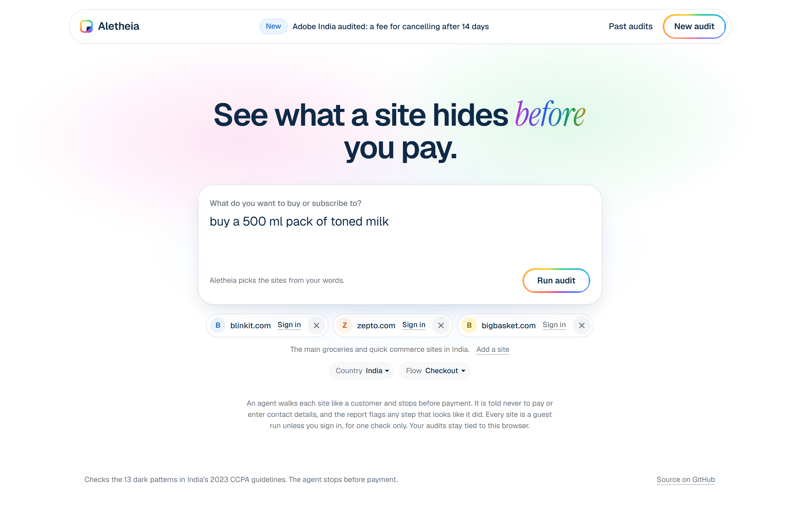
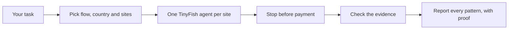
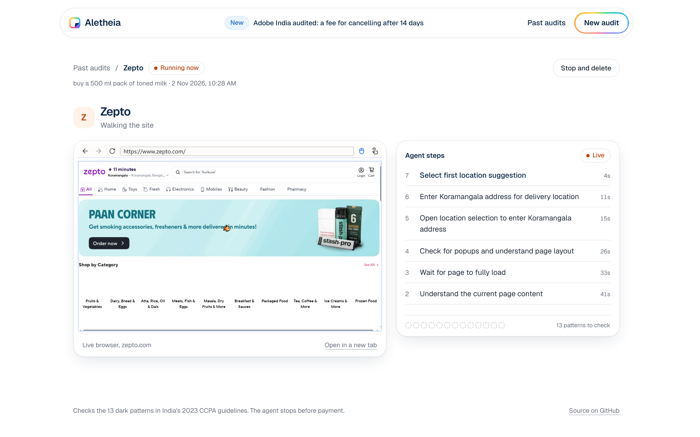
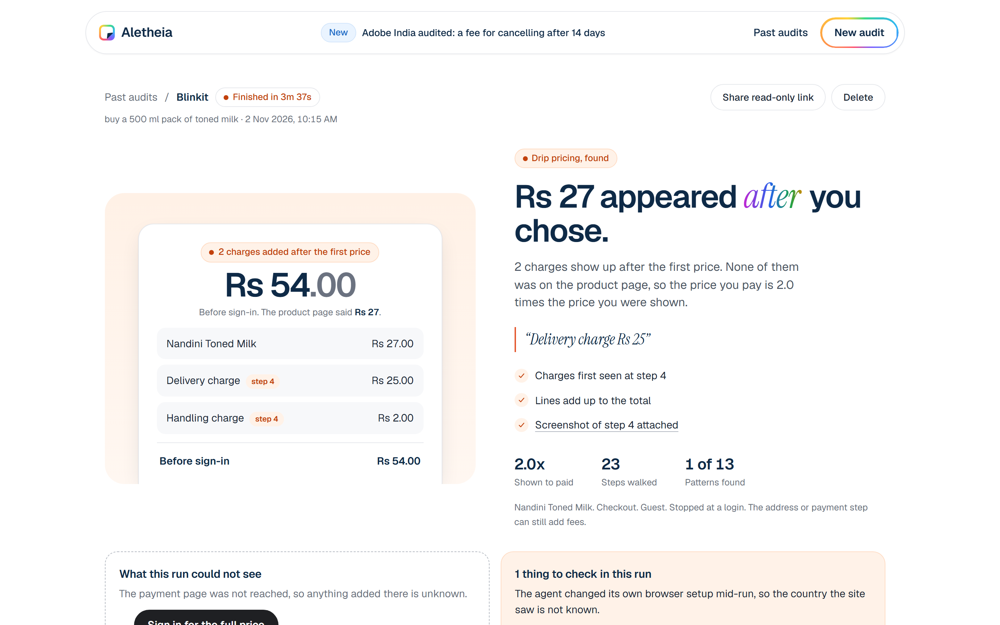
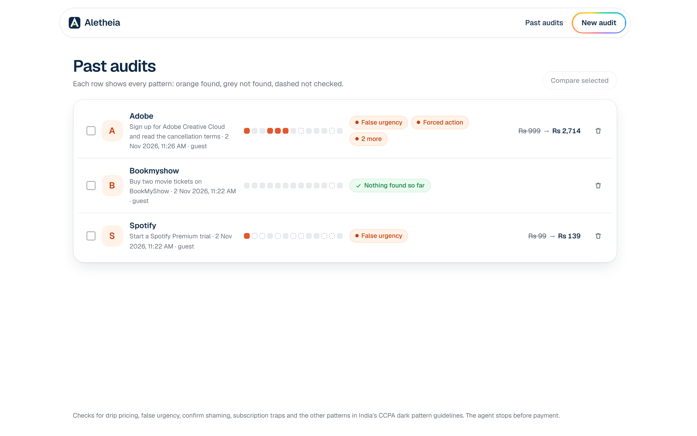

<p align="center">
  
</p>

<h1 align="center">Aletheia</h1>

<p align="center">Find the dark patterns on any website, with proof.</p>

<p align="center"><a href="https://aletheia.romitraj.dev">aletheia.romitraj.dev</a></p>



## The problem

India's CCPA dark pattern guidelines ban drip pricing, false urgency, confirm shaming, subscription traps and more, on every platform selling to people in India.
These patterns live deep in a flow: Adobe's fee for leaving early sits one page after its refund promise, in a sign-up nobody reads to the end.
Nobody can walk every flow by hand, so Aletheia does it and brings back proof.

## How it works

Name a site and a flow in your own words. Aletheia works out the flow and the country, and picks the sites: a brand you named, or the main national sites for that kind of product. You can change the sites, and you never have to.



Each site gets its own agent, which walks the flow like a customer as a guest. You watch the steps and the browser live.



The agent proposes, and our rules decide. Numbers are checked by arithmetic: the lines on a bill must add up to its total. Wording such as false urgency needs the exact quote and a screenshot, and is shown as seen with proof, not as a verdict. A pattern on a page the run never reached is marked not checked, so a login wall never earns a clean report.



Past audits stay in your browser. Compare sites, share a read-only link, or delete any report.



## How TinyFish is used

- **Agent:** runs each site in a stealth browser from the visitor's country, streams its steps and a live view, and returns structured evidence through an output schema.
- **Search:** finds a site when the task names one we do not know, or when a country or category is not in our site data.
- **Screenshots:** every step's screenshot is the report's proof. The server proxies them, so the key never reaches the browser.
- **Browser profiles:** "Sign in to see more" lets you log in yourself, one-time code included, for one check. The run then logs out and the profile is deleted.

Runs follow TinyFish's run ids, so a dropped stream picks up the same run. The runner enforces its own time limit and cancels a run that overruns.

## Setup

You need [Vite+](https://viteplus.dev), Node 26 and a TinyFish key in `.env` (see `.env.example`).

```
git clone https://github.com/brixdorf/aletheia.git
cd aletheia
vp install
vp run dev
```

`vp test` runs the unit tests. `vp run e2e` runs the full flow in a browser on saved runs and needs no key. `vp run wipe` deletes every saved audit, screenshot and sign-in in `DATA_DIR`; stop the server first.

## Team

Romit Raj Sahu and Abhijit P, Scaler School of Technology, Bangalore.

The code is source available under the [PolyForm Noncommercial License 1.0.0](LICENSE). Commercial use needs written permission from the authors.
