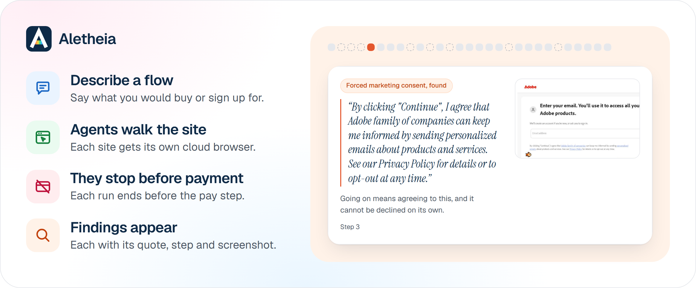

<p align="center">
  <a href="https://aletheia.romitraj.dev"></a>
</p>

<h1 align="center">Aletheia</h1>

<p align="center">Find the dark patterns on any website.</p>

<p align="center"><a href="https://aletheia.romitraj.dev">aletheia.romitraj.dev</a></p>

<a href="https://aletheia.romitraj.dev"></a>

Aletheia walks a site's checkout or sign-up flow like a customer, stops before payment and reports the dark patterns it saw. Each finding comes with its quote, its step and a screenshot.

## What it finds

- **Drip pricing:** fees that appear late in the flow, above the price first shown.
- **Subscription traps:** renewals and exit fees tucked out of sight, and sign-ups that are easy to start and hard to leave.
- **Confirm shaming:** wording that guilts you out of saying no.
- **Basket sneaking:** items or fees added to your cart without asking.
- **False urgency:** countdowns and stock warnings that push a rushed decision.
- **Forced action:** making you do something extra, such as creating an account you do not need, before you can continue.
- **Nagging:** the same prompt, again and again.
- **Trick questions:** confusing wording that steers your answer.
- **Interface interference:** design that hides the fair choice or dresses up the costly one.
- **Bait and switch:** advertising one thing and selling another.
- **Disguised ads:** adverts made to look like content.
- **SaaS billing:** recurring charges that are hard to notice or stop.
- **Rogue malware:** pages that push fake warnings or unwanted downloads.

## How it works



## Built with

[TinyFish](https://tinyfish.ai), TypeScript, Hono, React and Bun.

## Setup

You need [Vite+](https://viteplus.dev), Node 26 and a TinyFish key in `.env` (see `.env.example`).

```
git clone https://github.com/brixdorf/aletheia.git
cd aletheia
vp install
vp run dev
```

## Licence

Source available under [PolyForm Noncommercial 1.0.0](LICENSE.md). Commercial use needs written permission from the authors.

## Team

Romit Raj Sahu ([brixdorf](https://github.com/brixdorf)) and Abhijit P ([adx19](https://github.com/adx19)).
